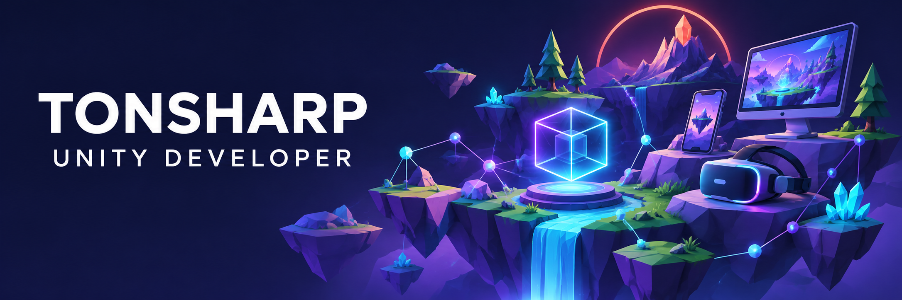
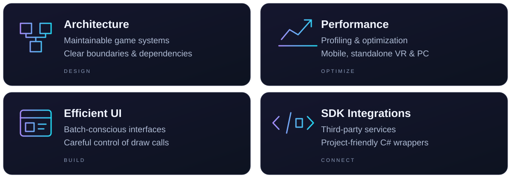
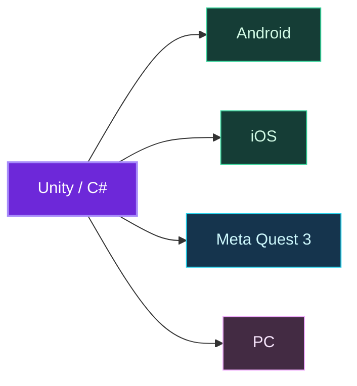

# Hi, I'm Anton Labokha 👋

**Unity Developer at Cleverside · Building games with C# since 2021**

Architecture · Performance · Cross-platform development

## 🎮 About me

I'm a Unity developer with **5+ years of commercial experience**, currently working at **Cleverside**. I design game architecture and optimize games for the hardware they run on — from mobile devices to standalone VR and PC.

My main focus is Unity, with a broader interest in **C# and .NET** beyond game development.

### What I bring to a project

### Platforms I've shipped on

Commercial releases across mobile, standalone VR, and PC — including performance optimization for **Meta Quest 3**.

## 🛠️ My toolkit

**Async & reactive**  

**Dependency injection & messaging**  

**Assets & animation**  

I also have experience with **Zenject**; **VContainer** is my current choice for dependency injection.

## 🤖 AI in my workflow

I effectively apply AI in my day-to-day Unity development with **Codex** and **Claude Code**. I use **Unity CLI** and **custom Unity CLI commands** to integrate these tools into my development workflow.

## 🔎 Beyond Unity

In my spare time, I explore **reverse engineering of Windows binaries**. I'm interested in understanding game entities and memory structures, and building APIs for existing games to support modding.

## 🎓 Education

**Polotsk State University** · Faculty of Information Technology  
Bachelor's degree in Information Technology Software · **Graduated in 2024**

## 📬 Let's connect

[LinkedIn](https://www.linkedin.com/in/t0nsharp/) · [Telegram](https://t.me/T0nSharp)  
Email: [aospextented@gmail.com](mailto:aospextented@gmail.com) · [t0nsharp@yandex.by](mailto:t0nsharp@yandex.by)
